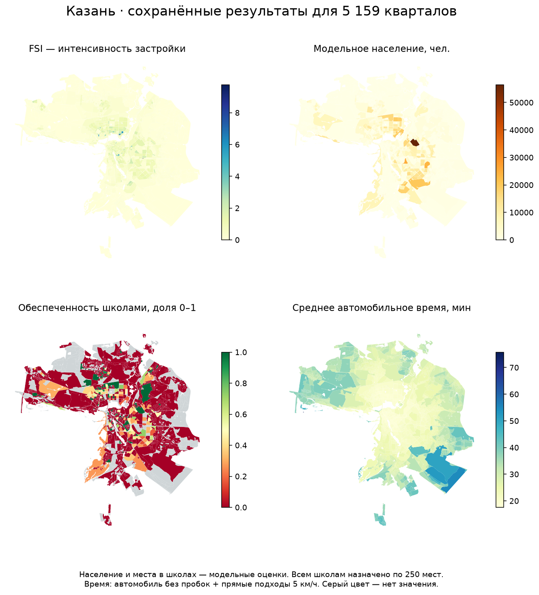

Казань: кварталы и метрики города — ДЗ 1
========================================

Учебное исследование всей Казани с BlocksNet 1.0.0a9. Сохранены результаты
для 5159 кварталов. Исходный шаблон проекта — python-package-boilerplate;
его лицензия и история сохранены.

.. image:: https://github.com/Vlada494/urban-ai-practice/actions/workflows/tests.yml/badge.svg?branch=main
   :target: https://github.com/Vlada494/urban-ai-practice/actions/workflows/tests.yml
   :alt: Результат текущей проверки main

Где посмотреть результат
------------------------

* Интерактивная карта: https://vlada494.github.io/urban-ai-practice/
* Выполненный ноутбук: examples/kazan_homework.ipynb.
* HTML для прикрепления в форме: dashboard.html.
* Все данные: https://github.com/Vlada494/urban-ai-practice/releases/tag/homework-1

Готовые результаты
------------------

* dashboard.html — одна HTML-страница: интерактивная карта, 47 показателей,
  графики, полные таблицы кварталов, характеристики кластеров и выводы.
* examples/kazan_homework.ipynb — выполненный ноутбук: все 26 ячеек кода
  выполнены без ошибок; план, запросы, определения, выводы и повторный запуск.
* examples/data — исходные GeoJSON, результаты, матрица времени и метаданные.
* CONCLUSIONS.txt — краткие выводы; SUBMISSION.txt — инструкция сдачи.

Просмотр и сборка
----------------

Публикация интерактивной карты в GitHub Pages
~~~~~~~~~~~~~~~~~~~~~~~~~~~~~~~~~~~~~~~~~~

Карта опубликована из ветки main, папки /docs. Готовый docs/index.html —
копия dashboard.html; Python на сервере не запускается. Открыть карту:
https://vlada494.github.io/urban-ai-practice/

Карта при обычном открытии файла HTML на github.com не исполняется.
Для интерактивного просмотра используйте GitHub Pages либо скачайте HTML.
Пересборка make_dashboard.py обновляет и dashboard.html, и docs/index.html.

Откройте dashboard.html двойным щелчком или OPEN_DASHBOARD.cmd.
Карта кварталов, показатели, графики и Leaflet находятся внутри HTML.
Для подложки OpenStreetMap нужен интернет.

Пересобрать страницу из сохранённых результатов в PowerShell::

    .venv\Scripts\python.exe make_dashboard.py

Код только читает готовые файлы. Модельные расчёты и загрузка не повторяются.
Логика сборки находится в my_package/dashboard_builder.py, шаблон и библиотека
карты — в my_package/dashboard_assets. Все зависимости ведутся в pyproject.toml.

Для новой среды используйте Python 3.12 и ``python -m pip install -e .``.
Точный снимок установленной среды — requirements-lock.txt. При необходимости
полного воспроизведения используйте этот файл вместо произвольного обновления
зависимостей. Ноутбук выполняет студент, по ячейкам сверху вниз.

Данные и передача
----------------

Полный переносимый архив исходных данных и результатов:
submission/kazan_homework_complete.zip (создаётся prepare_submission.py).
В нём есть полная матрица Parquet, GeoJSON, готовый граф и скачанные срезы
Overture; источник не исчезнет вместе со старым выпуском на сервере.
Архив не содержит .venv и временных кэшей. Контрольные суммы — manifest.json.
Крупная копия матрицы CSV исключена из архива как дубликат Parquet.

Архив данных опубликован вместе с проектом:
https://github.com/Vlada494/urban-ai-practice/releases/tag/homework-1

Скачайте kazan_homework_complete.zip. После распаковки внутри будет папка
urban-ai-practice. Если проект уже клонирован, скопируйте из архива содержимое
examples/data в examples/data вашего проекта, сохранив вложенные папки.
Полная матрица лежит в examples/data/kazan_acc_mx.parquet, готовый граф —
в examples/data/kazan_overture_drive.graphml, срезы Overture — в
examples/data/overture. Исходные и итоговые GeoJSON находятся рядом.
Архив содержит контрольные суммы submission_manifest.json.
Полный список требований и путей: SUBMISSION_CHECKLIST.txt.

Ограничения
-----------

Модельное население — не официальная статистика. Все 237 объектов школ
имеют восстановленную вместимость 250 мест. Обеспеченность — учебный сценарий,
не доказательство реального дефицита. Время автомобильное, без пробок,
с прямыми подходами 5 км/ч; это не пешеходный норматив. Пропуски и
неопределённые типы сохранены, а не заменены нулём. Источники: OpenStreetMap,
региональный экстракт Татарстана и Overture Transportation 2026-10-21.0.

Сдача
-----

https://forms.yandex.ru/cloud/6ad22113c45c078cec3c7c7d/

Прикрепляется отдельный dashboard.html размером менее 20 МБ. Нужны ФИО
и ссылка на свой GitHub. Факт сдачи подтверждается ответом формы.

Исходный шаблон
----------------

Проект основан на шаблоне Vasilii Starikov:
https://github.com/vasilstar97/python-package-boilerplate
Лицензия BSD-3-Clause сохранена в LICENSE; история исходного проекта сохранена.
